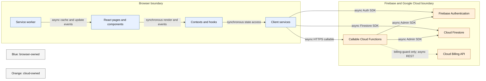

# Application architecture

Runtime boundaries and source paths refer to the checked-out commit and must be reviewed whenever their owning modules move.

## Runtime topology

Arrows labelled `synchronous` stay within the browser call stack. Arrows labelled `async` cross an asynchronous API, persistence, or worker boundary.

## Browser responsibilities

| Layer                     | Primary location                                          | Responsibility                                                                                         |
| ------------------------- | --------------------------------------------------------- | ------------------------------------------------------------------------------------------------------ |
| Application shell         | `src/App.tsx`                                             | Global providers, authentication gate, startup states, routes, header, settings, and notifications     |
| Pages and feature UI      | `src/pages/`, `src/components/`                           | Presentation and user interactions                                                                     |
| Shared UI                 | `src/ui/`                                                 | Reusable visual, interaction, and accessibility contracts                                              |
| Context and subscriptions | `src/context/`, `src/hooks/`                              | React state, query construction, listener cleanup, stale-callback protection, and request coordination |
| Backend services          | `src/services/`                                           | Firestore reads and writes, callable invocations, transactions, batches, and persistence boundaries    |
| Domain contracts          | `src/types/`, `src/constants/`, `src/data/`, `src/utils/` | Browser contracts, limits, browser-only reference data, validation and formatting                      |
| Shared rules              | `shared-rules/`                                           | Career, talent and weapon training data, plus pure purchase, cost, rank and Spent XP rules             |

Generic modules must not import feature components. Feature modules may compose shared foundations, while category-specific forms, validation, and card composition remain with their domains.

`shared-rules/` is a package with its own build that both `src/` and `functions/` depend on. `shared-rules/src/index.ts` defines the public API, and both consumers import it as `shared-rules`; neither consumer imports compiled `dist` modules directly. This makes removed or renamed shared exports fail during compilation instead of remaining available through compatibility shims.

`shared-rules/` also holds the Recovery Code format (`RECOVERY_CODE_PREFIX`, `RECOVERY_CODE_SEGMENTS`, `RECOVERY_CODE_SEGMENT_LENGTH`, `RECOVERY_CODE_ALPHABET` and `isRecoveryCodeFormat`) and the claim log action names (`CLAIM_LOG_ACTIONS`). The browser and the Functions both read these from the package. Code generation stays in each environment because the browser and Node use different random sources, and `firestore.rules` keeps its own copy of the format check because rules files cannot import code.

`shared-rules/` also holds the restricted character summary (`computeCharacterSummaryFields` and `isSummaryRelevantField` in `shared-rules/src/characterSummary.ts`) and the character document size limits (`CHARACTER_DOCUMENT_LIMITS` in `shared-rules/src/characterLimits.ts`: 900,000 bytes per document, 200 array entries, 100 object keys, nesting depth 8 and 4,000 characters per string). `computeCharacterSummary` in `src/services/characterService.ts` and the `patchCharacterField` callable derive the summary through the same function, and `PRODUCT_LIMITS` and `functions/src/shared/characterFieldValidation.ts` read the same limits. `firestore.rules` keeps its own copies of those numbers because rules files cannot import code.

Custom-item data keys and payload bounds also live in `shared-rules/src/customItemValidation.ts`. The browser uses them for early feedback, and the `mutateCustomItem` callable uses the same checks as the trusted write boundary. Direct client create, update and delete operations on custom-item definitions and versions are denied by Firestore Rules. Reads remain available under the existing campaign and creator access checks. The callable checks the authenticated account link and campaign role, then writes the item and version together for draft creation. `scripts/auditCustomItems.mjs` is a read-only pre-rollout scan against the same validator. Set `CUSTOM_ITEM_SCAN_PROJECT_ID` to the exact target project before running `npm run audit:custom-items`.

Run the read-only custom-item audit before each environment rollout and resolve any reported records. On staging, deploy Functions, publish the client that calls them, then deploy the restrictive Firestore Rules. Repeat that order on production. No data migration is required because existing documents keep their current shape. Do not deploy the denying Rules before the client release has propagated.

| Experience component             | Owning location                                  | Responsibility                                                                                         |
| -------------------------------- | ------------------------------------------------ | ------------------------------------------------------------------------------------------------------ |
| Shared Career and purchase rules | `shared-rules/src/`                              | Career progression, Career-table access, purchase attribution, purchase costs and Spent XP calculation |
| Rank card preparation            | `src/mechanics/experience/rankCards.ts`          | Converts character purchases into browser presentation records                                         |
| Rank Up request preparation      | `src/mechanics/experience/xpTransactions.ts`     | Prepares Rank Up choices and spending transactions without authoritatively changing Spent XP           |
| Talent picker calculations       | `src/mechanics/experience/talentAdvanceCosts.ts` | Produces Talent slot, chip and picker information using the shared Career slot rules                   |

`src/firebase.ts` initializes Firebase Authentication, Cloud Firestore, and callable Functions. Portraits are validated and stored as character data; the client does not initialize Firebase Storage.

### Input autofill

Every text, textarea, number, date and search input sets `autoComplete="off"`, because the Android autofill suggestion row takes a large part of the screen above the keyboard and no field collects a password, address or card. Search boxes also use `type="search"` with a `name`, since `autoComplete="off"` alone does not hide the row there; `src/ui/pickers/PickerModal.tsx` owns the shared picker search. `tests/unit/inputAutofill.test.ts` enforces this.

### Pending overlay

`src/ui/PendingOverlay.tsx` is the shared loading indicator. It is a dimmed layer with the loading dots that covers the area that is waiting, and it appears only after `PENDING_OVERLAY_DELAY_MS` (200 milliseconds, `src/constants/ui.ts`) and disappears when the wait ends. A wait shorter than the delay shows nothing. `src/pages/CharacterSheet.tsx` switches tabs inside a React transition, so the previous tab stays on screen while a tab that has not downloaded loads, and the overlay covers the tab area for a slow switch. The sheet downloads the code for all nine on-demand tabs in the background when it opens, and those downloads read no data. Panels that load when pressed stay closed until their data is complete: the Admin tab's claim history (`AdminTab.tsx`), a character's History pop-up (`CharacterRow.tsx`), a conversation in the Inbox pop-up (`ChatConversation.tsx`) and the force-assign player picker (`PlayerPicker.tsx`). The Inbox pop-up opens at once and shows the overlay in place of a conversation's messages until they arrive (`ChatConversation.tsx`). A Delete confirmation (`ConfirmInline.tsx`) stays closed until the count of affected documents has loaded, with the overlay over the row or window that was pressed (`CharacterRow.tsx`, `CustomItemAdminRow.tsx`, `Dashboard.tsx`). A character release or loss of access shows the overlay over an empty frame until the Dashboard replaces the page (`CharacterSheet.tsx`). The Experience tab reads its XP history from `src/hooks/xpHistoryStore.ts`, which owns one live listener per character and suspends the first read until the first snapshot arrives, so the tab switch waits for the history like any other tab; the listener is released `XP_HISTORY_RELEASE_MS` (30 seconds) after the last reader leaves.

### Page switching

`src/components/RouteHolder.tsx` owns page switches. When the path changes, the previous page stays visible and usable while the new page is built out of sight beside it, and its listeners start at once. Each part of a page that waits for data registers with `useRouteLoading` (`src/context/useRouteReady.ts`), and the new page replaces the old one when nothing is still waiting, so the Campaign Overview and the Character Sheet appear complete. `PendingOverlay` covers the old page only after `PENDING_OVERLAY_DELAY_MS`. A page still loading after `ROUTE_LOAD_TIMEOUT_MS` (30 seconds, `src/constants/ui.ts`) is revealed with its load error. The first page on a load or reload stays behind the logo screen until it is ready. A page sets its header menu, back link and chat target only while it is the visible page (`useRouteActive`), and does so before the screen is drawn. `RouteHolder` reports the path of the visible page through `onShownChange`, and `AppHeader` uses that path and not the address bar, so the header changes in the same picture as the page. A change to the query string within a page, such as switching tabs, does not rebuild the page.

### Shared card and picker styles

The same kind of element looks and behaves the same everywhere, and colour is the only difference between two uses of one element. Each piece below has one owner.

| Piece                  | Owner                                                                                                                                                                                                                                                                                                                                                                    | Role                                                                                                                                                                                                                                                                                                                                                                                                                                                                                                                                                                                                                                                                                                                                                                                                                                                                                                                                                                 |
| ---------------------- | ------------------------------------------------------------------------------------------------------------------------------------------------------------------------------------------------------------------------------------------------------------------------------------------------------------------------------------------------------------------------ | -------------------------------------------------------------------------------------------------------------------------------------------------------------------------------------------------------------------------------------------------------------------------------------------------------------------------------------------------------------------------------------------------------------------------------------------------------------------------------------------------------------------------------------------------------------------------------------------------------------------------------------------------------------------------------------------------------------------------------------------------------------------------------------------------------------------------------------------------------------------------------------------------------------------------------------------------------------------- |
| Card                   | `uiSectionShell` and `uiSection` in `src/ui/styles/editableStyles.ts`, and `src/ui/Panel.tsx`                                                                                                                                                                                                                                                                            | The bordered card; `uiSection` and `Panel` add the card padding                                                                                                                                                                                                                                                                                                                                                                                                                                                                                                                                                                                                                                                                                                                                                                                                                                                                                                      |
| Inner box              | `uiCell` in `editableStyles.ts` and `src/ui/chips/StatChip.tsx`                                                                                                                                                                                                                                                                                                          | The bordered box inside a card; `StatChip` is built on it                                                                                                                                                                                                                                                                                                                                                                                                                                                                                                                                                                                                                                                                                                                                                                                                                                                                                                            |
| Layout recipe          | `uiChipRow`, `uiInlineRow`, `uiSplitRow`, `uiSplitRowTop`, `uiTwoColumnGrid`, `uiSummaryGrid`, `uiOptionGrid`, `uiInputRowGrid`, `uiStatGrid` and `uiSectionColumns` in `editableStyles.ts`                                                                                                                                                                              | Shared wrapping chip rows, centred inline rows, split rows (`uiSplitRow` centres its two sides and `uiSplitRowTop` keeps them at the top, for entries whose left side runs to several lines) and grids: `uiTwoColumnGrid` for form fields and footer buttons, `uiSummaryGrid` for summary values, `uiOptionGrid` for option buttons, `uiInputRowGrid` for a row of three inputs, `uiStatGrid` for compact stat cells, and `uiSectionColumns` for sections shown side by side; the grids that omit a column count take it from the caller, which adds only its local alignment, margin, size or responsive classes                                                                                                                                                                                                                                                                                                                                                    |
| Table                  | `uiTable`, `uiTableHeaderRow`, `uiTableBody`, `uiTableHeaderCell`, `uiTableCell`, `uiTableScroll`, `uiTableFirstCell`, `uiTableNumberHeaderCell` and `uiTableNumberCell` in `src/ui/styles/tableStyles.ts`                                                                                                                                                               | The shared width, responsive text size, primary text, heading treatment, slate-700 dividers, vertical cell spacing, sideways scrolling, the gap after the first column and the centred number cells; every table has an accessible name and `scope="col"` on its headings, and keeps only its local column widths and other alignment                                                                                                                                                                                                                                                                                                                                                                                                                                                                                                                                                                                                                                |
| Application layer      | `uiLayerLocal`, `uiLayerBackdrop`, `uiLayerForeground`, `uiBackdropBlur` and `uiDrawerDuration` in `src/ui/styles/layerStyles.ts`                                                                                                                                                                                                                                        | Local controls, loading covers and the Scroll to top button sit above nearby content, page backdrops sit above them, and drawers, the header, menus and fallback floating UI sit above a backdrop; native dialogs and supported popovers use the browser top layer                                                                                                                                                                                                                                                                                                                                                                                                                                                                                                                                                                                                                                                                                                   |
| Interaction state      | `uiPressFeedback`, `uiHoverSurface`, `uiFieldButtonFeedback`, `uiOpacityHover`, `uiFocusRing`, `uiFocusRingInset`, `uiFocusWithinRing`, `uiDisabledControl` and `uiDisabledLook` in `buttonStyles.ts`, with state colours in `colourTokens.ts`                                                                                                                           | Every interactive control uses the same slight press shrink (`scale-press`, defined once in `tailwind.config.cjs`), reduced-motion behaviour, `transition` fade, red keyboard focus ring and opacity-50 disabled look; the hover follows the control's family in the table below, while semantic button variants keep their named colour                                                                                                                                                                                                                                                                                                                                                                                                                                                                                                                                                                                                                             |
| Chip                   | `Chip` in `src/ui/chips/Chip.tsx`, `chipColours` in `src/ui/styles/colourTokens.ts`, and the chip colour lookups in `src/ui/styles/sourceStyles.ts`                                                                                                                                                                                                                      | A compact passive label with one base shape and size scale; a caller picks the colour by name (`colour="amber"`) and never passes colour classes; every named colour uses its matching `500/50` border, `500/10` fill and `300` text, source abbreviations also use the code font, and read-only labels such as DM authority, Immutable and Read-only use the same slate Chip                                                                                                                                                                                                                                                                                                                                                                                                                                                                                                                                                                                          |
| Removable chip         | `RemovableChip` in `src/ui/chips/RemovableChip.tsx`                                                                                                                                                                                                                                                                                                                      | A Chip with one shared close control named `Remove [name]`; without confirmation it immediately edits unfinished form state, as used for attendees and weapon qualities, while saved data opens `RemoveEntryModal`, waits for the server and closes only after success, as used for Background quirks                                                                                                                                                                                                                                                                                                                                                                                                                                                                                                                                                                                                   |
| Notice box             | `uiNoticeBox` with `colourNoticeAmber`, `colourNoticePink`, `colourNoticeViolet`, `colourNoticeRed`                                                                                                                                                                                                                                                                      | A tinted box for a warning or highlighted state                                                                                                                                                                                                                                                                                                                                                                                                                                                                                                                                                                                                                                                                                                                                                                                                                                                                                                                      |
| Text tone              | `colourTextPrimary`, `colourTextBody`, `colourTextMuted`, `colourTextPlaceholder`, `colourErrorText` and `colourSuccessPlain` in `src/ui/styles/colourTokens.ts`, with `uiTextBody`, `uiTextPlaceholder`, `uiTextError`, `uiTextGMNote`, `uiTextDescription`, `uiDescriptionBox`, `uiTextMeta`, `uiRuleName` and `uiThresholdValue` in `src/ui/styles/editableStyles.ts` | Shared colours and text recipes for names and values, body copy, muted and empty text, errors, plain success text, descriptions, supporting lines, rule names and highlighted numbers                                                                                                                                                                                                                                                                                                                                                                                                                                                                                                                                                                                                                                                                                                                                                                                |
| Heading                | `uiPageTitle`, `uiToolbarTitle`, `uiModalTitle`, `uiDrawerTitle`, `uiActionRowLabel`, `uiSectionHeader`, `uiSubheading` and `uiCardTitle`                                                                                                                                                                                                                                | Shared roles for page, toolbar, modal, drawer, action-row, section, subheading and card titles                                                                                                                                                                                                                                                                                                                                                                                                                                                                                                                                                                                                                                                                                                                                                                                                                                                                       |
| Glow chip              | `GlowChip` in `src/ui/chips/GlowChip.tsx`, with `colourGlowActive` and `colourGlowInactive` in `src/ui/styles/colourTokens.ts`                                                                                                                                                                                                                                           | The compact active or inactive glow treatment used by passive Psychic discipline statuses and Weapon Training controls; it owns the shared size, colours, optional pulse in the glow of its own colour (`colourGlowPulseRgb`) and button states, while Talent-granted Exotic Weapon Training remains passive                                                                                                                                                                                                                                                                                                                                                                                                                                                                                                                                                                                                                                                         |
| Recovery code box      | `uiCodeBox` and `uiCodeText` in `editableStyles.ts`                                                                                                                                                                                                                                                                                                                      | The box that shows a recovery code                                                                                                                                                                                                                                                                                                                                                                                                                                                                                                                                                                                                                                                                                                                                                                                                                                                                                                                                   |
| Expanding card         | `src/ui/AccordionCard.tsx`                                                                                                                                                                                                                                                                                                                                               | The one expandable card. A tappable header built on `CardOverlayButton` and `CharacterEntryRowContent` holds a name, badge, information icon, chips, remove and other actions and an expand chevron, and the body beneath it has the shared card padding with no top divider. It takes a `tone` for the plain, amber, pink or red shell, an `onSelect` for a picker card whose tap chooses it, `forceExpanded` for a card shown open with no toggle, and a `label` that gives the accessible name "Expand X details". Every expandable card uses it: the Talent, Trait, Skill and Career purchase groups, the Rank card, the weapon cards and Ranged weapon picker rows, the Companion cards, the Psychic power card and the Archeotech item card. Every card starts collapsed, whether or not its weapon is equipped, and a card with an `onSelect` shows a spinner in place of its chevron while the select is saving                                              |
| Character entry row    | `src/ui/CharacterEntryRow.tsx`                                                                                                                                                                                                                                                                                                                                           | One owned Skill, Talent or other character entry, with shared card padding, name and information placement, normal-size metadata chips, secondary information and a wrapping upper-right action area that shows the remove action first, the other actions next, and the expand control last with extra room before it. `CharacterEntryRowContent` owns this layout for flat rows and for the interactive card headers of `AccordionCard` and Notes; in a card header the name, information icon and every action sit above the tap overlay, so each works on its own                                                                                                                                                                                                                                                                                                                                                                                                |
| Entry removal          | `RemoveEntryButton` in `src/ui/RemoveEntryButton.tsx` and `RemoveEntryModal` in `src/ui/modals/RemoveEntryModal.tsx`                                                                                                                                                                                                                                                       | `RemoveEntryModal` owns the saved-data removal question, standard title, waiting state, success closure and refusal recovery used by character entries, Background quirks and both Weapon Training removals; `RemoveEntryButton` supplies the shared trash trigger, blocked explanation and exceptional alternate action, while Notes use Delete because they are permanently erased                                                                                                                                                                                                                                                                                                                                                                                                                                                                                                                       |
| Owned entry row        | `src/ui/OwnedEntryRow.tsx`                                                                                                                                                                                                                                                                                                                                               | One owned entry on a character sheet, built on `CharacterEntryRow`; the caller supplies content and the row owns the layout: the information icon (always shown, "No description recorded." when empty), one aligned chip row, the labelled lines in the fixed order Craftsmanship, Duration, Qualities, Rules, Gained from, Talent effects and Notes, the trash button named after one fixed list of kinds, the Draft or Published badge and custom item buttons for a library item, and a body area for extra content such as Upgrades or Spare Cells; Skills, Talents, Traits, Elite Advances, Mutations, Malignancies, Disorders, Trauma, Gear items, Consumables, Drugs, Implants, Armour pieces, Force fields, Archeotech armour, force fields and implants, and the flat Archeotech item row are built on it                                                                                                                                                  |
| Entry action button    | `src/ui/buttons/EntryActionButton.tsx` with `uiEntryActionSize` in `buttonStyles.ts`                                                                                                                                                                                                                                                                                     | The button for an action on an owned entry, such as Upgrade, Edit Rolls, Escalate, Wear or Equip; extra small on phones, taller from 640 pixels and larger from 768 pixels                                                                                                                                                                                                                                                                                                                                                                                                                                                                                                                                                                                                                                                                                                                                                                                           |
| Entry detail line      | `src/ui/EntryDetailLine.tsx`                                                                                                                                                                                                                                                                                                                                             | One labelled line inside an entry, such as Qualities, Rules, Craftsmanship, Gained From or Duration, with the blue label, the value as text, an optional information control after it, and a dash when there is neither a value nor information                                                                                                                                                                                                                                                                                                                                                                                                                                                                                                                                                                                                                                                                                                                      |
| Info section           | `src/ui/InfoSection.tsx` with `uiRuleName` in `editableStyles.ts`                                                                                                                                                                                                                                                                                                        | A headed section inside an information window, with `InfoParagraph` for its description text; the heading and every rule name share one style, uppercase, bold and blue at the larger size; `InfoModal` shows "No description recorded." when it is given no content                                                                                                                                                                                                                                                                                                                                                                                                                                                                                                                                                                                                                                                                                                 |
| State toggle button    | `src/ui/buttons/StateToggleButton.tsx`                                                                                                                                                                                                                                                                                                                                   | The button that switches an entry between two states, such as Equip and Unequip, with the green outline when active, the three responsive sizes of `EntryActionButton` (the extra-small `Button` size on narrow phones, `sm:h-7 sm:px-2.5` from 640 pixels and `md:h-8 md:px-3 md:text-sm` from 768 pixels), and a small status chip in place of the button when the sheet is read-only; `EquipToggle` in `weaponShared.tsx` supplies the Equip words                                                                                                                                                                                                                                                                                                                                                                                                                                                                                                                |
| Picker row             | `PickerRow` and `PickerList` in `src/ui/pickers/PickerModal.tsx`                                                                                                                                                                                                                                                                                                         | A card that is one button. A row passes `opensScreen` to show the drill-down arrow, and passes `selected` only when it is a chosen or not chosen row, which also sets `aria-pressed`; the optional `trailing` slot holds other end content                                                                                                                                                                                                                                                                                                                                                                                                                                                                                                                                                                                                                                                                                                                           |
| Picker pop-up          | `PickerModal`, `PickerBody` and `PickerList` in `src/ui/pickers/PickerModal.tsx`                                                                                                                                                                                                                                                                                         | The frame for a list or a short multi-step pick: a header, an optional search box, a body that scrolls while the header and footer stay fixed, and a footer under a divider line; the Concealed Weapon Bionic installer uses it without search, with Back and Cancel in the footer                                                                                                                                                                                                                                                                                                                                                                                                                                                                                                                                                                                                                                                                                   |
| Drawer navigation row  | `SectionDrawerRow` in `src/ui/SectionDrawerRow.tsx`                                                                                                                                                                                                                                                                                                                      | The category, back and page rows in the section drawer share one layout and interaction treatment; category and back arrows stay on the right as trailing row content, and the current page differs only through its red text colour                                                                                                                                                                                                                                                                                                                                                                                                                                                                                                                                                                                                                                                                                                                                 |
| Section drawer         | `SectionDrawer` in `src/components/SectionDrawer.tsx`                                                                                                                                                                                                                                                                                                                    | The hamburger drawer takes its entries as input, either categories with pages or one list of pages with no category level, and reports the chosen page id; the character sheet supplies its tabs from `src/pages/CharacterSheet/sectionNavigation.ts`                                                                                                                                                                                                                                                                                                                                                                                                                                                                                                                                                                                                                                                                                                                |
| Campaign page sections | `CampaignOverview` in `src/pages/CampaignOverview.tsx` with `src/pages/CampaignOverview/sections.ts`                                                                                                                                                                                                                                                                     | The campaign page shows one section at a time, chosen by the `section` query value (`party`, `custom-items` or `sessions`, with `party` the default); `custom-items` is DM only, and a missing, unknown or disallowed value is replaced by `party`; each section (`PartySection`, `CustomItemLibraryAdmin`, `SessionHistorySection`) subscribes to its own data only while it is open and covers its area with `PendingOverlay` through `SectionPending` while it loads; the burger menu is the `SectionDrawer` with a plain list of pages                                                                                                                                                                                                                                                                                                                                                                                                                           |
| Corners                | `uiCorner` and `uiCornerSmall` in `src/ui/styles/shapeStyles.ts`                                                                                                                                                                                                                                                                                                         | Every card, inner box, text box, button, toggle, chip, pop-up and window takes the one `uiCorner` (`rounded-lg`); the very small boxes (the info button, the quantity step buttons, the advance squares, the Psy Rating square and the 16px checkbox box) take `uiCornerSmall`; circles and pills keep `rounded-full`; `tests/unit/cornerStyles.test.ts` fails on any hand-typed corner class                                                                                                                                                                                                                                                                                                                                                                                                                                                                                                                                                                        |
| Manage windows         | `ManageModal` and `ManageActionRow` in `src/ui/modals`, with `DeleteConfirmModal` and `RevealCodeModal` beside them                                                                                                                                                                                                                                                      | The window opened by a gear button is one ManageModal with one ManageActionRow per action (bold label, info icon, icon button on the right); the Dashboard's Manage Campaign window and the Party list's Manage Character window both use it; every permanent delete asks for DELETE to be typed through DeleteConfirmModal; every recovery code, the account code in Settings and a character code in Manage Character, opens in RevealCodeModal with Copy code and Rotate Code                                                                                                                                                                                                                                                                                                                                                                                                                                                                                     |
| Picker row contents    | `PickerRowName`, `PickerRowChips`, `PickerRowLine`, `PickerRowRulesLine` and `PickerRowText` in `src/ui/pickers/PickerRowParts.tsx`                                                                                                                                                                                                                                      | The name line, which takes a custom item `status` for the status badge and an `infoTitle` that always shows the information icon, with the empty message when no description is recorded; the chip row; a labelled line built like the lines of an owned entry (`PickerRowLine`), including the Rules line (`PickerRowRulesLine`), which shows only when the entry has rules; and a description line. The Add Skill picker rows are `SkillPickerRow` in `SkillsTab`, built on the same pieces with the skill's chips, its Total, and its Gained from and Talent effects lines in the standard colours. The Ranged, Melee, Grenade, Shield and Integrated weapon pickers do not use these pieces: they list the expandable select card (`RangedPickerCard` and `MeleePickerCard` in `WeaponPickerCards.tsx`, `GrenadeCard` and `ShieldCard`), where a tap chooses the weapon, the chevron opens its full card, and a custom weapon shows its status badge on the name |
| Filter button          | `FilterButton` in `src/ui/pickers/FilterButton.tsx`                                                                                                                                                                                                                                                                                                                      | A button in a picker's filter row, such as a class filter or Show all, with centred words, the card border and fill, and no arrow                                                                                                                                                                                                                                                                                                                                                                                                                                                                                                                                                                                                                                                                                                                                                                                                                                    |
| Form field button      | `PickerField` in `src/ui/pickers/PickerField.tsx`                                                                                                                                                                                                                                                                                                                        | A form box that opens an option list, with a label above, left-aligned words and an arrow on the right                                                                                                                                                                                                                                                                                                                                                                                                                                                                                                                                                                                                                                                                                                                                                                                                                                                               |
| Text box               | `editableInputClass`, `editableInputLargeClass` and `editableInputColour` in `src/ui/styles/editableStyles.ts`                                                                                                                                                                                                                                                           | The box where text or numbers are typed; `editableInputLargeClass` is the taller box with no fixed width that fills a row beside a button, used by the chat message box; `editableInputColour` gives the fill, border and red selected border to a box that sets its own size                                                                                                                                                                                                                                                                                                                                                                                                                                                                                                                                                                                                                                                                                        |
| Action button          | `Button` in `src/ui/buttons/Button.tsx`                                                                                                                                                                                                                                                                                                                                  | Every standalone action button, including Back and the Campaign options menu rows, in the `neutral` variant when it carries no meaning of its own                                                                                                                                                                                                                                                                                                                                                                                                                                                                                                                                                                                                                                                                                                                                                                                                                    |
| Icon button            | `IconButton` in `src/ui/buttons/IconButton.tsx`                                                                                                                                                                                                                                                                                                                          | Every button that shows only an icon, including Options, the section menu, the inbox, the message buttons on character rows and cards, and scroll to top, with the red outline, press shrink, red focus ring and a spinner while it works                                                                                                                                                                                                                                                                                                                                                                                                                                                                                                                                                                                                                                                                                                                            |
| Icon                   | Components in `src/ui/icons/`, with `IconProps` in `iconTypes.ts`, `uiIconSize` in `src/ui/styles/iconStyles.ts` and `colourIconMuted` in `colourTokens.ts`                                                                                                                                                                                                              | Shared `currentColor` pictures and glyph replacements, drawn as stroke 2 lines on a 24 grid apart from the filled Heart and Experience pictures and the Eye; every size is a named `uiIconSize`, controls own their accessible labels, and muted chevrons and arrows use one colour token                                                                                                                                                                                                                                                                                                                                                                                                                                                                                                                                                                                                                                                                            |
| Tappable card          | `CardOverlayButton` in `src/ui/buttons/CardOverlayButton.tsx`, with `uiCardTapHeader` in `buttonStyles.ts` and `uiCardTitleHover` in `editableStyles.ts`                                                                                                                                                                                                                 | The invisible button over a card header that chooses or expands the card; the button owns the hover tint, the pressed sink and the red focus ring, and the title beside it turns white only while that button is hovered (`uiOverlayPeerHoverText`); the header content sits above the button, so hovering Equip, the information icon or another control does not highlight the card                                                                                                                                                                                                                                                                                                                                                                                                                                                                                                                                                                                |
| Toggle button          | `ToggleButton` and `toggleButtonClass` in `src/ui/buttons/ToggleButton.tsx`                                                                                                                                                                                                                                                                                              | One button in a pick-one row, such as craftsmanship, a weapon profile or a starting choice; the unselected look and the pressed state are shared, and the caller passes the selected colour and its own size                                                                                                                                                                                                                                                                                                                                                                                                                                                                                                                                                                                                                                                                                                                                                         |
| Required mark          | `RequiredMark` in `src/ui/forms/RequiredMark.tsx`                                                                                                                                                                                                                                                                                                                        | The asterisk beside a required field, in `colourRequiredText` and hidden from screen readers; `FormLabel` with `required`, the required note and every hand-labelled field use it                                                                                                                                                                                                                                                                                                                                                                                                                                                                                                                                                                                                                                                                                                                                                                                    |
| Checkbox row           | `CheckboxRow` in `src/ui/forms/CheckboxRow.tsx`                                                                                                                                                                                                                                                                                                                          | The one tick box with its sentence: a 16 pixel box in the red accent (`colourInputAccent`) lined up with the first line of text, `text-sm lg:text-base` in `uiTextBody`, a pointer cursor while enabled, an optional required mark, and extra classes such as centring; the Talent acquisition confirmations, the recovery code confirmation in Onboarding, the session delete option and the custom Archeotech armour form all use it                                                                                                                                                                                                                                                                                                                                                                                                                                                                                                                               |
| Cost pop-up            | `XpCostForm` in `src/ui/forms/XpCostForm.tsx`                                                                                                                                                                                                                                                                                                                            | The one pop-up that asks for an XP cost before a purchase: a Details box with a required XP Cost field, the Required note, and a submit button and Cancel, built on `CustomFormShell`; the Talent, Skill, Skill upgrade, Elite Advance, Train Weapon Group and Add Exotic Weapon pop-ups all use it                                                                                                                                                                                                                                                                                                                                                                                                                                                                                                                                                                                                                                                                  |
| Confirmation pop-up    | `ConfirmModal` in `src/ui/modals/ConfirmModal.tsx`                                                                                                                                                                                                                                                                                                                       | The one pop-up that asks a short question: a centred sentence, a two-column footer with the confirm button on the left and Cancel on the right, the waiting state on the confirm button, an optional custom label for the dismiss button, a no-close-button option for a choice that must be answered, a content slot between the sentence and the buttons, an extra full-width action, a single Close button when there is nothing to confirm, and a slot for two answers that fill the two columns; built on `ModalShell`; the Escalate, Upgrade and Downgrade Characteristic, Close Session, Skill upgrade, Weapon Training, Archive Campaign, Rotate Code, Cancel New Account Setup, Release, Keep Your Chat, typed-DELETE, Remove, and Settings unlink pop-ups use it                                                                                                                                                                                           |
| Expand button          | `ExpandButton` in `src/ui/buttons/ExpandButton.tsx`                                                                                                                                                                                                                                                                                                                      | The chevron that expands or collapses a card's details, above the card's tap overlay                                                                                                                                                                                                                                                                                                                                                                                                                                                                                                                                                                                                                                                                                                                                                                                                                                                                                 |
| Reveal button          | `RevealCodeButton` in `src/ui/buttons/RevealCodeButton.tsx`, with `uiTextButton` in `buttonStyles.ts`                                                                                                                                                                                                                                                                    | The underlined inline link that shows a recovery code, with waiting dots while it loads                                                                                                                                                                                                                                                                                                                                                                                                                                                                                                                                                                                                                                                                                                                                                                                                                                                                              |
| Info button            | `uiInfoButton` in `src/ui/styles/buttonStyles.ts`                                                                                                                                                                                                                                                                                                                        | The small raised button used by `InfoModal`                                                                                                                                                                                                                                                                                                                                                                                                                                                                                                                                                                                                                                                                                                                                                                                                                                                                                                                          |
| Step button            | `uiStepButtonColour` and `uiStepButtonDisabled` in `buttonStyles.ts`                                                                                                                                                                                                                                                                                                     | The plus and minus buttons of `Stepper` and `QuantityControl`                                                                                                                                                                                                                                                                                                                                                                                                                                                                                                                                                                                                                                                                                                                                                                                                                                                                                                        |

The Position Portrait pop-up is built directly on `ModalShell` because its crop area and zoom slider have no shared home. Its Save and Cancel sit on `uiTwoColumnGrid`, the same footer grid as `ConfirmModal`.

Every picker row builds its inside from the four row content pieces, and these gaps apply to all of them:

| Part             | Gap above (px) | Text                                                  |
| ---------------- | -------------- | ----------------------------------------------------- |
| Name line        | 0              | `uiItemNameHover`, which wraps and is never truncated |
| Chip row         | 4              | Chips set their own size                              |
| Info line        | 4              | Small label, optional text, then the info icon        |
| Description line | 4              | Small `uiTextBody` text                               |

`PowerCard` uses its four-column grid on a phone and changes to the same wrapping layout and gap as `uiChipRow` on desktop. The responsive classes remain with `PowerCard` because applying `uiChipRow` at every size would replace its phone grid.

`editableStyles.ts` owns the five vertical stack gaps, and every stack of items in `src` takes one of them. `tests/unit/layoutRecipes.test.ts` rejects a hand-typed `space-y-` class anywhere else.

| Name             | Gap (px) | Used for                                                            |
| ---------------- | -------- | ------------------------------------------------------------------- |
| `uiStackPage`    | 24       | The sections of a tab or page                                       |
| `uiStackBody`    | 16       | The body of a modal, form, panel or information modal               |
| `uiStackSection` | 12       | A section heading and its content, and the body of an expanded card |
| `uiStackList`    | 8        | Cards in a list, and a bordered detail area inside a card           |
| `uiStackField`   | 4        | A label with its value or control, and the items of a bullet list   |

`Panel` takes its default spacing from `uiStackPage` and its compact spacing from `uiStackBody`. `IndependentCardGrid` uses `uiStackList` for its column stacks and 8 px between its columns, so it has no spacing option.

The Armour Location Summary and Explosive Mishaps tables use the shared styles from `tableStyles.ts`. Both use slate-200 body text, the compact label style for headings, a slate-700 line below the headings and slate-700 lines between rows. Both scroll sideways in `uiTableScroll`, leave the same gap after the first column, and carry an accessible name and `scope="col"` on every heading. Their column widths and other alignment remain local. Table rows are passive and do not show a hover state.

`DrawerBackdrop` owns the backdrop behind `SectionDrawer`. It stays mounted while closed so its fade completes with the drawer slide, both using `uiDrawerDuration` (300 milliseconds), blocks pointer input only while open, uses the shared black/50 colour and the page blur from `uiBackdropBlur`, and closes its drawer when pressed. `ModalShell` remains a separate native-dialog kind with its darker black/70 backdrop, the pop-up blur from `uiBackdropBlur` and the browser top layer. `PendingOverlay` remains a local slate loading cover rather than a page backdrop.

`buttonStyles.ts` owns the shared interaction states. `uiPressFeedback` shrinks an interactive control to 98 per cent while it is pressed and returns it to full size when the device requests reduced motion; the 98 per cent is the `press` scale in the Tailwind theme and every press class names it. `uiFocusRing` gives controls the red keyboard focus ring, `uiFocusRingInset` draws the same ring inside the element for a control stretched over a card or clipped by a rounded parent such as the Stepper pill, and `uiFocusWithinRing` gives the ring to a label that contains the focused control. Every control fades its hover with `transition`. `uiFieldButtonFeedback` gives a button that looks like a text box, such as a picker field or the Age button, the slate hover and the press while it can be used. A click-to-edit number in `Stepper` and `QuantityControl` is a real button that opens its editor with Enter or Space, and `useReturnFocusAfterEdit` returns focus to it when Enter or Escape closes the editor. `uiDisabledControl` covers native disabled controls and `uiDisabledLook` covers a disabled state applied conditionally to another element. Loading controls use their waiting state instead of the disabled look so their progress remains readable. Hover colours and semantic button variants have one definition in `colourTokens.ts`.

The hover follows the control's family:

| Control family                                                                                        | Hover                                      | Tokens                                                                                                                                   |
| ----------------------------------------------------------------------------------------------------- | ------------------------------------------ | ---------------------------------------------------------------------------------------------------------------------------------------- |
| Flat tappable surfaces: cards, picker rows, filter buttons, tabs, drawer rows, field buttons, chevron | Slate-800 fill                             | `colourHoverSurface`, `colourEnabledHoverSlateSurface`, `colourOverlayHoverSurface`                                                      |
| Raised controls: info and step buttons, the secondary button                                          | Slate-600 fill                             | `colourHoverRaised`, `colourButtonSecondary`                                                                                             |
| Outlined red buttons: primary and icon buttons                                                        | Red tint at 10 per cent                    | `colourEnabledHoverRedTint`, `colourHoverAccentTint`                                                                                     |
| Amber, emerald and fuchsia outlined buttons                                                           | The same tint in their colour              | `colourButtonWarningOutline`, `colourButtonSuccessOutline`, `colourEnabledHoverEmeraldTint`, `colourEnabledHoverFuchsiaTint`             |
| Danger and warning ghost buttons                                                                      | A darker fill at 70 per cent               | `colourButtonDanger`, `colourButtonWarningGhost`                                                                                         |
| Characteristic advance squares                                                                        | Red border and a dark red fill             | `colourAdvanceHover`                                                                                                                     |
| Toast controls                                                                                        | White at 10 per cent                       | `colourHoverToastControl`                                                                                                                |
| Text controls and links                                                                               | The text lightens; a card name turns white | `colourHoverTextPrimary`, `colourHoverTextBody`, `colourEnabledHoverTextBody`, `colourGroupHoverTextStrong`, `colourPeerHoverTextStrong` |
| Chips and coloured text buttons                                                                       | Dim to 80 per cent                         | `uiOpacityHover`                                                                                                                         |
| Editable numbers and values                                                                           | The text lightens with a dotted underline  | `uiEditableValueHover`                                                                                                                   |

`src/ui/icons/` owns interface pictures and glyph replacements. Shared icons use `currentColor`, are hidden from assistive technology and take their size from a `uiIconSize` name; an icon given no size follows the text around it. The surrounding control or visible text provides the accessible name. Every icon is a line drawing with a stroke width of 2 and round ends on a 24 grid, except Heart and Experience, which are filled, and Eye, which is a drawn solid shape. The sizes in use are listed below. `tests/unit/iconStandards.test.ts` rejects inline SVG pictures and the audited interface glyphs outside the icon directory.

| Job                                                                                                                                                          | Size                                   | Name                             |
| ------------------------------------------------------------------------------------------------------------------------------------------------------------ | -------------------------------------- | -------------------------------- |
| An icon that follows its text: plus and minus on counters, steppers and quantity controls, the weight icon on chips, Heart and Experience on a player's card | The size of the text around it         | `inline`                         |
| An icon in an icon button                                                                                                                                    | 18 pixels, or 16 pixels in a small one | `uiIconButtonIconSize.md`, `.sm` |
| The toast status icon, Copy, Check and dismiss cross, and the Scroll to top arrow                                                                            | 18 pixels                              | `px18`                           |
| The close cross of a pop-up or drawer                                                                                                                        | 18 pixels, 20 pixels from 1024 wide    | `closeCross`                     |
| The cross on a removable chip                                                                                                                                | 18 pixels                              | `px18`                           |
| The expand chevron and the picker arrows                                                                                                                     | 16 pixels, or the size they are given  | `px16`                           |
| Spinners in a picker row and an accordion card                                                                                                               | 16 pixels                              | `px16`                           |
| The information icon in its small button                                                                                                                     | 10 pixels                              | `px10`                           |
| The plus badge on the portrait                                                                                                                               | 12 pixels                              | `px12`                           |
| The portrait placeholder                                                                                                                                     | 24 pixels                              | `px24`                           |
| The error page warning and the start-up spinner                                                                                                              | 32 pixels                              | `px32`                           |

`PickerRow` adds the `group` class only when the row responds to a press, so the name turns white on hover and the box lightens together, and a read-only row shows neither. Pressing an info icon opens its pop-up and does not select the row (`PickerRowName`). A row never places chips or a cost to the right of its name. The body font, IM Fell English, loads in its normal and italic faces (`src/main.tsx`), and `font-synthesis: none` in `src/index.css` stops the browser from faking an italic; no component sets italic text.

Use `uiTextBody` for readable rules, notes and explanations, and `uiTextDescription` for a description paragraph inside a modal, a picker detail screen or a card body, with `uiDescriptionBox` for the filled box that holds it on an item detail screen. Use `uiTextMeta` for a small supporting line such as a date, a creator or a count, `uiTextPlaceholder` for an empty, missing or optional value, and `uiTextError` for a plain inline error message, while the component keeps its own size. Use `uiRuleName` for a rule or ability name above its description inside an info modal, `uiThresholdValue` for a bold highlighted number inside a sentence, and `colourAmberPlain` for secondary game information such as a granted source or stowed quantity. Use `colourSuccessPlain` for a plain success message.

Shared text-tone tokens do not replace specialist visual styles. Controls compose the shared press, hover, focus and disabled states with their selected state. Chips and badges own a linked border, fill and text treatment. Colours on mechanical values, thresholds, rewards, danger states, side effects and terminal outcomes carry game information and remain with the component or domain token that owns that meaning.

### Chip colours

Every chip takes its colour from the 18 names in `chipColours` (`src/ui/styles/colourTokens.ts`). The same meaning always gets the same colour: an XP cost, a price, an Owned tag, a Draft tag, the roll chip and the Archeotech label are all amber, and weight, per-quantity and neutral labels are slate. Each map below returns a colour name, and a component that needs the class string for a toggle's selected look reads `chipColours[name]`.

`Chip`, `StatChip` and `ItemMetaChips` own the normal size used by primary cards, rows, pickers and top-level metadata. `NestedChip`, `NestedStatChip` and `NestedItemMetaChips` own the small size used inside ammunition, magazine, attachment and upgrade content. Call sites do not pass `size="sm"` directly, and the layout guard rejects any direct small-chip override outside the chip owner.

`readWeightKg` and `formatWeightForDisplay` in `src/ui/format/weightFormat.ts` own the reading of every stored weight, and the weapon, armour, ammunition and item chip code all read weights through them. A weight that is a dash reads as 0 kg and shows `0 kg`. A weight that is `Varies` reads as unknown and shows the word `Varies` until a weight is entered, and an empty weight reads as unknown and shows no chip. A trailing footnote dagger is dropped and the number is used, and a weight with extra words after the unit, such as `4 kg case`, shows as written. A weapon or armour piece whose base weight is unknown has no effective weight, so it shows no weight chip even with upgrades fitted. `AssignedItemMetaFields` asks for a required weight when a reference item's weight is `Varies`, in the Gear and Archeotech assign pop-ups, and the Gear and Archeotech tabs store the entered weight on the character's copy of the item, so an owned item never shows the word `Varies`. `calcCarriedWeightKg` in `src/mechanics/carriedWeight.ts` adds up everything a character owns and returns kilograms: weapons with their upgrades and spare ammunition, armour and force fields, shields, gear, and Archeotech at their weights, Consumables, Drugs, Grenades, and thrown weapons times their quantity, and a cybernetic only while it is not installed. Integrated weapons, installed cybernetics, and unusable weights count 0, and the result is shown on no screen. The ammunition weights come from the same helpers the Ranged and Melee cards use.

| Meaning                            | Owner                                                                                             | Colours                                                                                                                            |
| ---------------------------------- | ------------------------------------------------------------------------------------------------- | ---------------------------------------------------------------------------------------------------------------------------------- |
| Source book                        | `sourceChipColour` in `src/ui/styles/sourceStyles.ts`                                             | One colour per source code; the core rulebook and unknown sources are slate                                                        |
| Availability                       | `availabilityChipColour` in `sourceStyles.ts`                                                     | One colour per availability; Adeptus Mechanicus Only and Tech-Priest Only are both red; unrecognised and compound values are slate |
| Characteristic                     | `characteristicChipColour` in `sourceStyles.ts`                                                   | Amber for combat, green for physical, blue for mental, pink for social                                                             |
| Weapon class, type and ammo family | `weaponClassChip`, `weaponTypeChip`, `ammoFamilyChip` and `meleeClassChips` in `weaponHelpers.ts` | Las is red, Launcher yellow, Exotic fuchsia, and SP weapons and Solid Projectile ammo teal, on every chip that shows them          |
| Craftsmanship                      | `CRAFTSMANSHIP_COLOUR` in `src/ui/styles/craftsmanship.ts`                                        | Poor red, Common slate, Good emerald, Best amber; `CRAFTSMANSHIP_STYLE` is built from `colourToggleSelected`                       |
| Custom item status                 | `StatusBadge` in `src/ui/chips/StatusBadge.tsx`                                                   | Published emerald, draft amber, archived slate                                                                                     |
| Psychic discipline and selection   | `disciplineColours` and `psychicSelectionSourceColours` in `PsychicTab/psychicStyles.ts`          | One colour per discipline; a Talent selection is amber and a Psy Rating selection is indigo                                        |
| Insanity and corruption            | `insanityUi.ts` and `corruptionUi.ts`                                                             | Degree, severity and disorder type colours                                                                                         |
| Faith Talent group                 | `FAITH_TALENT_GROUP_CHIP_COLOURS` in `src/mechanics/talents/faithTalentGroups.ts`                 | General slate, Sign violet, Mercy emerald, Wrath amber                                                                             |
| Rank card entry kind               | `ENTRY_KIND_COLOURS` in `ExperienceTab.tsx`                                                       | One colour per kind of purchase                                                                                                    |
| Skill level and kind               | `LEVEL_BADGE` in `SkillsTab/skillRowShared.tsx`                                                   | Untrained red, Trained orange, +10 sky, +20 green; Basic teal and Advanced purple                                                  |

`tests/integration/Chip.test.tsx`, `tests/unit/sourceStyles.test.ts` and `tests/unit/weaponHelpers.test.ts` cover the palette and the maps.

### Text and surface colours

Each raw colour class is written once, under `src/ui/styles`, and every other style, token and file builds from that one definition, so a colour changes in one place. `colourTokens.ts` holds the single class tokens and the colour tables `chipTextColours`, `chipColours` and `colourToggleSelected`, and `tests/unit/textRecipes.test.ts` fails when a class is written in more than one definition there or typed outside it. The `Button` variant `danger` uses `colourButtonDanger`, a dark red tint with red text and no outline, for permanent deletion and for actions that remove access. The `warning` and `success` variants use the amber and emerald outlines, and ordinary removal keeps the red outline of `primary`. Moving a chat to Recently Deleted uses `warning` because the chat can be restored. The loading spinner and the portrait zoom slider take their red from `colourSpinnerAccent` and `colourInputAccent`.

| Group                       | Tokens                                                                                                                                                                                                                                                                                                                                                                                                  | Use                                                                                                                              |
| --------------------------- | ------------------------------------------------------------------------------------------------------------------------------------------------------------------------------------------------------------------------------------------------------------------------------------------------------------------------------------------------------------------------------------------------------- | -------------------------------------------------------------------------------------------------------------------------------- |
| Primary and supporting text | `colourTextPrimary` (names, values, headings, form labels), `colourTextBody`, `colourTextMuted`, `colourIconMuted`, `colourTextPlaceholder`, `colourMetadataLabelText`, `colourTextGMNote`                                                                                                                                                                                                              | The grey scale of text and icons, from the lightest name to a placeholder, and the sky blue of small labels                      |
| Accent and state text       | `colourHeadingAccent` (red titles), `colourErrorText` (errors, required marks, negative values), `colourSuccessPlain`, `colourAmberPlain`, `colourNoticeAmberTitle`, `colourNoticeAmberText`, `colourOnAmberDim`, `colourTerminalText`, `colourPsychicText`, `colourDrugNoticeText`, `colourSplashTitle`, `colourCustomEntryText`                                                                       | Text that carries a title, a warning or a game meaning                                                                           |
| Dividers and borders        | `colourDivider`, `colourDivideList`, `colourAccentBar`, `colourBorderRed`, `colourBorderControl`, `colourSplashRule`                                                                                                                                                                                                                                                                                    | The line between sections, the line between list rows, the red accent bar and the control border                                 |
| Surfaces                    | `colourPageBackground`, `colourPopoverSurface`, `colourModalSurface`, `colourDrawerBackdrop`, `colourModalBackdrop`, `colourModalBackdropSuspended`, `colourFillPanel`, `colourFillRaised`, `colourFillControl`, `colourFillInset`, `colourFillSelected`, `colourFillHeader`, `colourFillFloating`, `colourControlSurface`, `colourControlRaised`, `colourTabTrackSurface`, `colourEditOverrideSurface` | The fill of the page, menus, drawers, modals, their backdrops, panels, controls, inset boxes, the header and the floating button |
| Controls and marks          | `colourControlSurfaceDisabled`, `colourControlDivider`, `colourControlDividerDisabled`, `colourStateRed`, `colourSpinnerAccent`, `colourInputAccent`, `colourAdvanceFilled`, `colourAdvanceEmpty`, `colourDotLoaded`, `colourDotIdle`, `colourTimelineMarker`, `colourQrBackground`                                                                                                                     | The counter, advance squares, loaded dot, timeline marker, spinner and slider accents and QR background                          |
| Shadows and glows           | `colourShadowStrong`, `colourShadowRaised`, `colourControlShadow`, `colourGlowSilver`, `colourGlowPulseCore`, `colourGlowPulseRgb`                                                                                                                                                                                                                                                                      | Shadow levels for menus, toasts and the counter, the Characteristics glow and the glow pulse colours                             |
| Selected toggles            | `colourToggleSelected` (one entry per colour, built from `chipColours`), `colourToggleSelectedViolet` and `colourToggleSelectedFuchsia` (the Talents and Skills tabs)                                                                                                                                                                                                                                   | The selected look of a pick-one button, which is the chip look of its colour in semi-bold text                                   |
| Shared class names          | `chipTextColours`, `colourTextOnFill`, `colourBorderFuchsia`, `colourBorderAmber`, `colourFillAmberFaint`, `colourBorderFuchsiaSoft`, `colourBorderEmeraldSoft`, `colourBorderAmberGlow`, `colourBorderVioletGlow`                                                                                                                                                                                      | A class that two or more tokens share, written once and read by each                                                             |
| Palettes                    | `degreeTextColour` and `degreeBarColour` (Insanity and Corruption steps), `damageTypeTextColour`, `toastColours`                                                                                                                                                                                                                                                                                        | One colour set shared by every place that shows the same meaning                                                                 |

The page background is slate-950, owned by `colourPageBackground`. The same `#020617` is written in the `:root` rule of `src/index.css`, the `theme-color` meta tag in `index.html` and the `theme_color` and `background_color` of the manifest in `pwaOptions.ts`, because none of them can read a Tailwind class. Root text falls back to slate-200 (`#e2e8f0`). The static splash in `index.html` uses the same red-500 title and spinner as `SplashScreen`. `tests/unit/indexSplash.test.ts` and `tests/unit/pwaConfiguration.test.ts` fail when those places differ.

Menus, drawers and pop-ups share `colourShadowStrong`. Toasts and the Scroll to top button share `colourShadowRaised`, and the counter builds `colourControlShadow` from the raised shadow with a darker colour. The active Characteristics block on a phone takes `colourGlowSilver`. A pulsing `GlowChip` sets its own `--glow-lo` and `--glow-hi` variables from `colourGlowPulseRgb`, keyed by its colour name, and the Psy Rating square scales the same indigo entry with its rating.

Hover, focus, press and disabled colours stay inside the style of the control that owns them. `tests/unit/textRecipes.test.ts` fails when a hand-typed text, background, border or divider colour, or a copy of the shared text recipes, appears outside the files listed above and the files that own hover, icon, table and backdrop colours.

Scrollbars are styled once in `src/index.css`: every scrollable area, including pop-ups and the page, uses a thin scrollbar with the thumb colour `--scrollbar-thumb` (slate-600) and a transparent track. No component styles a scrollbar of its own. Browsers that do not support `scrollbar-width` and `scrollbar-color` keep their default scrollbar.

## Navigation and startup

The routed application exposes these canonical paths:

| Route                                          | Owner             |
| ---------------------------------------------- | ----------------- |
| `/`                                            | Dashboard         |
| `/campaign/:campaignId`                        | Campaign overview |
| `/campaign/:campaignId/character/:characterId` | Character sheet   |

Settings is a modal owned by the application shell. Legacy path constants such as `/dm`, `/player`, and `/select` are not registered routes and fall through to the dashboard.

`CampaignsProvider` is global in `src/App.tsx`; its active DM, active member and archived campaign subscriptions start during authenticated startup and remain active across routes. Route pages add only their own scoped subscriptions.

### Startup gate

`src/components/StartupGate.tsx` keeps the logo screen until the active DM campaigns, the active member campaigns, the archived campaigns and the recovery backup status have all arrived, so the Dashboard and its backup banner appear complete. `src/components/StartupErrorModal.tsx` shows a modal over the logo screen when any of those loads fails or when startup exceeds `STARTUP_LOAD_TIMEOUT_MS` (30 seconds, `src/constants/ui.ts`). The modal cannot be closed and offers one Try Again action that reloads the application. Failures in sign-in, the device list and the profile use the same modal. The gate decides once: after the application has opened, a later listener error appears in the affected list and never replaces the application.

## Query and product bounds

`src/constants/firestoreLimits.ts` is authoritative for live query windows.

| Query                                  | Maximum requested documents |
| -------------------------------------- | --------------------------: |
| Active DM campaigns                    |                         100 |
| Active member campaigns                |                         100 |
| Archived campaigns                     |                         100 |
| Campaign characters                    |                         100 |
| Session records or summaries           |                         200 |
| Chats per account                      |                         200 |
| Current or requested chat message page |                         100 |
| Claim history page                     |                          50 |
| XP history page                        |                         100 |
| Custom-item query                      |                         200 |

Messaging keeps one copy of each chat per person under `users/{accountId}/chats`. `ChatsProvider` keeps one live listener on the signed-in account's chats from startup, and `StartupGate` waits for it. `ChatInboxProvider` holds which part of the Inbox pop-up is showing, and `ChatInboxModal` is mounted once in `src/App.tsx`. The header button, the message icon buttons on character rows and cards, and the character sheet open it through that context. The sheet publishes its chat target through the header extension before the page is drawn, so `HeaderMessagesButton` shows the inbox tray icon on ordinary pages, the speech bubble that opens that character's chat on a sheet whose character has a player, and nothing on a sheet whose character has no player. Writes go through the `sendChatMessage` and `exportChat` callables, the release and deletion operations, or a few owner-only field changes that the rules allow.

These values limit reads; they do not prove collection-size enforcement. `src/constants/productLimits.ts` declares product policy, while the enforcement layer differs by value.

| Policy value               |         Declared limit with units | Current enforcement                                               |
| -------------------------- | --------------------------------: | ----------------------------------------------------------------- |
| Campaign creation rate     | 10 creations per rolling 24 hours | Protected `createCampaign` operation                              |
| Campaigns per account      |                     100 campaigns | Protected `createCampaign` count check                            |
| Campaign members           |                   100 account IDs | Firestore rule validates the stored member array                  |
| Characters per campaign    |                    100 characters | Query window and declared policy; no collection-count write check |
| Linked devices per account |                        10 devices | Protected `linkDevice` count check                                |
| Custom items per campaign  |                         200 items | Query window and declared policy; no collection-count write check |
| Character import payload   |                     750,000 bytes | Client import validation                                          |
| Character document budget  |                     900,000 bytes | Application field and document validation                         |
| Character Total XP         |                     10,000,000 XP | `adjustCharacterXp` and session XP operation validation           |
| XP history reason          |                  4,000 characters | `adjustCharacterXp` operation validation                          |

## Trust and persistence boundaries

Firestore rules authorise every direct client read and write. `SECURITY_RULES.md` summarises that contract. Operations with sensitive cross-document or server-authority requirements use callable functions under `functions/src/operations/`.

Character field edits go through the `patchCharacterField` callable. Each field has a shape and size validator, and fields that carry XP-priced purchases also have a transition validator in `functions/src/shared/characterFieldValidation.ts`. A transition validator compares the proposed value with the stored character and the caller's role, using the same `shared-rules` cost and rank functions as the browser, including the character's selected Alternate Rank tables:

- `characteristics`: each newly bought advance is recorded at the career table cost, and no advance past the fourth tier is accepted.
- `skills`: each newly bought tier uses its Career-table cost, `getMissedRankCareerAdvances` prices a replaced normal-Rank Skill at its original cost plus 50 XP from the following Career tier, and a `gm-approved` Show all purchase requires matching recorded costs and DM authority even when the Skill is otherwise locked.
- `talentsAndTraits`: `assertValidTalentsAndTraitsTransition` checks new Career-table Talents and Traits against `getNextTalentOrTraitPurchase`, validates missed-rank and packaged Talent provenance, restricts manually priced Show all purchases to the DM, and validates purchased or automatically granted packaged Elite Advances. `isCustomTraitEntry` permits campaign custom Traits, while `isPurityReplacement` permits the free Reformed Skin entry created with a Purity of Flesh acquisition.
- `weaponTraining`: each newly trained fixed group is recorded at the career table cost, a group off the table is priced only by the DM, each career-table Exotic specialisation uses its printed cost and source rank, and only the DM adds off-Career Exotic Training as bonus training.
- `experience`: a player adds an Alternate Rank only when the career matches, the rank it replaces is one of the character's valid next ranks and meets the Alternate Rank's minimum rank, and it appears only once. The DM may set any Alternate Rank selection. `assertValidExperienceTransition` rejects direct changes to Total XP or Spent XP for every caller. `assertPlayerExperienceLedgerUnchanged` prevents players from adding, removing or changing the legacy Rank advance ledger or XP spending transactions; only the DM may manage those records. Current Career purchases use their dedicated fields and Career-table validators instead of creating legacy Rank advances.

`patchCharacterField` supplies transition validators with the complete proposed character, so one atomic update can validate a packaged Elite Advance and its unlocked Talent, or an Alternate Rank and its automatic packaged grant. Decreases and removals are not checked, because only additions create free XP. Fields without a transition validator are checked for shape and size only.

`assertExistingPurchasePricesUnchanged` protects retained XP purchase prices in Characteristics, Skills, Talents, Traits, packaged Elite Advances and Weapon Training. A player with character editing access may remove a purchase for a refund, but cannot add, remove or alter any cost field on a purchase that remains owned. The DM may reprice a retained purchase.

### Spent XP accounting

Spent XP is derived from persisted purchases and spending transactions. The browser may calculate the same value for presentation, but it does not supply the value accepted by the server.

| Behaviour                    | Owning component                                                                              | Server boundary                                                                                                                                                                   |
| ---------------------------- | --------------------------------------------------------------------------------------------- | --------------------------------------------------------------------------------------------------------------------------------------------------------------------------------- |
| Purchase total in XP         | `getSpentXp` in `shared-rules/src/xpSpent.ts`                                                 | Totals Rank advances, spending transactions, Characteristic Advances, Skills, Talents, Traits, standalone Elite Advances and Weapon Training                                      |
| Talent and Trait total in XP | `getTalentsSpent` in `shared-rules/src/talentAdvanceCosts.ts`                                 | Uses persisted purchase prices first and supports legacy Career-table or manual prices                                                                                            |
| Experience ledger protection | `assertPlayerExperienceLedgerUnchanged` in `functions/src/shared/characterFieldValidation.ts` | Keeps legacy Rank advances and XP spending transactions immutable for players while allowing DM management                                                                        |
| Atomic purchase validation   | `patchCharacterField` in `functions/src/operations/patchCharacterField.ts`                    | Calculates the complete proposed character total, rejects the full patch when Spent XP would exceed Total XP, and stores the calculated `experience.spent` with an accepted patch |
| Stored-value repair          | `reconcileCharacterSpentXp` in `functions/src/operations/reconcileCharacterSpentXp.ts`        | Accepts only character identity, recalculates from the freshly read character and updates only `experience.spent`                                                                 |
| Budget enforcement           | `assertCharacterXpBudget` in `functions/src/shared/spentXp.ts`                                | Rejects any proposed purchase state whose calculated Spent XP exceeds server-owned Total XP                                                                                       |

`adjustCharacterXp`, `applySessionXp`, `adjustSessionXp` and `deleteSession` also recalculate Spent XP from stored purchases. A negative adjustment, session adjustment or session reversal is rejected atomically when its resulting Total XP would be lower than calculated Spent XP. A session award remains atomic across all attendees: invalid stored purchase data for any attendee rejects the complete award without changing another attendee, the session or XP history.

### XP history

Total XP is a server-maintained aggregate. The Experience page displays its read-only history beneath the Total, Spent and Remaining XP summary.

| Behaviour                              | Owning component                                                       | Persistence boundary                                                                                                                                                     |
| -------------------------------------- | ---------------------------------------------------------------------- | ------------------------------------------------------------------------------------------------------------------------------------------------------------------------ |
| Manual positive or negative adjustment | `adjustCharacterXp` in `functions/src/operations/adjustCharacterXp.ts` | Updates `experience.total` and appends `/campaigns/{campaignId}/characters/{characterId}/xpHistory/{entryId}` in one transaction                                         |
| Existing-character baseline            | `stageOpeningBalance` in `functions/src/shared/xpHistory.ts`           | Creates the immutable `opening-balance` entry before the first adjustment                                                                                                |
| Session award                          | `applySessionXp` in `functions/src/operations/sessionXp.ts`            | Uses the stored session attendees and XP amount, updates every attendee total, writes history and marks the session applied in one transaction                           |
| Session start                          | `startSession` in `functions/src/operations/sessionLifecycle.ts`       | Creates an open session and its summary, and refuses when another session is already open, in one transaction                                                            |
| Session close with XP                  | `closeSession` in `functions/src/operations/sessionLifecycle.ts`       | Requires an open session, gives the XP to every attendee through `stageSessionAward`, saves the final values and marks the session closed and applied in one transaction |
| Session XP edit after applying         | `adjustSessionXp` in `functions/src/operations/sessionXp.ts`           | Gives or removes the difference for each attendee whose XP changes, writes a `session-adjustment` history entry and updates the session in one transaction               |
| Session deletion with reversal         | `deleteSession` in `functions/src/operations/sessionXp.ts`             | Writes a negative history entry, updates every attendee total and deletes the session records in one transaction                                                         |
| History subscription                   | `useXpHistory` in `src/hooks/useXpHistory.ts`                          | Reads at most 100 newest entries ordered by creation time                                                                                                                |
| History presentation                   | `ExperienceTab` in `src/pages/CharacterSheet/ExperienceTab.tsx`        | Shows amount in XP, resulting balance in XP, reason, actor and local date and time                                                                                       |

An editable owning player and an actively editing DM may record a manual adjustment. The resulting Total XP must remain at or above server-calculated Spent XP and may not exceed 10,000,000 XP. History entries are server-written and cannot be edited or deleted directly. A correction is a new positive or negative entry.

| Callable error code   | Meaning                                                         |
| --------------------- | --------------------------------------------------------------- |
| `unauthenticated`     | Firebase Authentication is missing or invalid                   |
| `permission-denied`   | The effective account lacks authority                           |
| `invalid-argument`    | The request payload fails validation                            |
| `not-found`           | A required target no longer exists                              |
| `already-exists`      | The requested identity or transition already exists             |
| `resource-exhausted`  | A rate, count, or bounded-operation limit is exceeded           |
| `failed-precondition` | Current stored state does not permit the operation              |
| `internal`            | An unexpected failure was converted to the generic safe message |

UI code must branch on error codes rather than private server details.

Text-field persistence is debounced by 600 milliseconds. Quantity deltas are coalesced for 300 milliseconds. Direct Firestore writes remain subject to rules; protected operations validate authority and state again on the server.

## Destructive and resumable operations

Campaign and character deletion use protected resumable jobs:

1. The protected preflight authorises the caller, counts affected documents, and stores a job without deleting descendants.
2. The client displays the stored count.
3. The user confirms processing in the UI.
4. The client requests bounded chunks until completion.

Parent documents are removed last so interrupted work can resume without leaving descendants detached from an existing parent.

The confirmation is a client workflow boundary, not a server-validated count token. Processing reauthorises the caller but does not perform a fresh count comparison at confirmation time.

Account deletion is a separate bounded transaction. It refuses deletion while the account owns campaigns and refuses a write set above its transaction ceiling.

Preconditions and failure behaviour are part of each operation's contract:

| Operation            | Required precondition                                                                                              | Failure behaviour                                                                           |
| -------------------- | ------------------------------------------------------------------------------------------------------------------ | ------------------------------------------------------------------------------------------- |
| Campaign deletion    | Caller is the campaign DM; every character has a valid Recovery Code; preflight count is at most 100,000 documents | Preflight creates no descendant deletion; processing reauthorises the caller and can resume |
| Character deletion   | Caller is the campaign DM; the character has a valid Recovery Code; preflight count is at most 100,000 documents   | Parent character remains until descendant cleanup completes                                 |
| Account deletion     | No owned campaigns and cleanup fits the bounded transaction                                                        | Transaction performs no partial Firestore cleanup on rejection                              |
| Ownership transition | Caller has operation-specific authority and current state matches                                                  | Transaction rejects races without a partial transition                                      |

## Cloud runtime

| Functions workload          | Region         |     Timeout | Maximum instances | Concurrency per instance |
| --------------------------- | -------------- | ----------: | ----------------: | -----------------------: |
| Ordinary protected callable | `europe-west2` |  30 seconds |       5 instances |              40 requests |
| Heavy protected callable    | `europe-west2` |  30 seconds |       2 instances |               5 requests |
| Account deletion            | `europe-west2` |  60 seconds |       5 instances |              40 requests |
| Chat export                 | `europe-west2` | 120 seconds |       2 instances |               5 requests |
| Scheduled chat purge        | `europe-west2` | 300 seconds |        1 instance |        One run at a time |

All five workloads target Node.js 22. Account deletion uses its dedicated runtime service account. The scheduled purge runs at 03:00 Europe/London without retries and logs only counts.

HMAC material is supplied through the deployed Functions secrets `RECOVERY_CODE_HMAC_SECRET` and `IDENTITY_CODE_HMAC_SECRET`, declared in `functions/src/shared/secrets.ts`. Secret values must never enter browser configuration or repository files.

The isolated `billing-guard/` package receives budget events and may detach billing from the two monitored projects. It is operational infrastructure, not part of the application request path.

## Progressive web application boundary

The production build registers a service worker and caches build assets. Startup state is coordinated between the pre-React registration code and the React shell so an unavailable registration or stalled update does not leave the interface permanently blocked. Cached-asset consistency is enforced by `npm run check:build-inventory`.

## Deployment boundary

Firebase Hosting serves `dist/` and rewrites application routes to the SPA entry point. `scripts/buildForDeploy.mjs` prepares the deployment build. Security headers and the Content Security Policy are defined in `firebase.json` and must be reviewed when external origins or runtime capabilities change.

Repository installation, test commands, and performance-harness methodology belong in `CONTRIBUTING.md`, not in this architecture contract.
